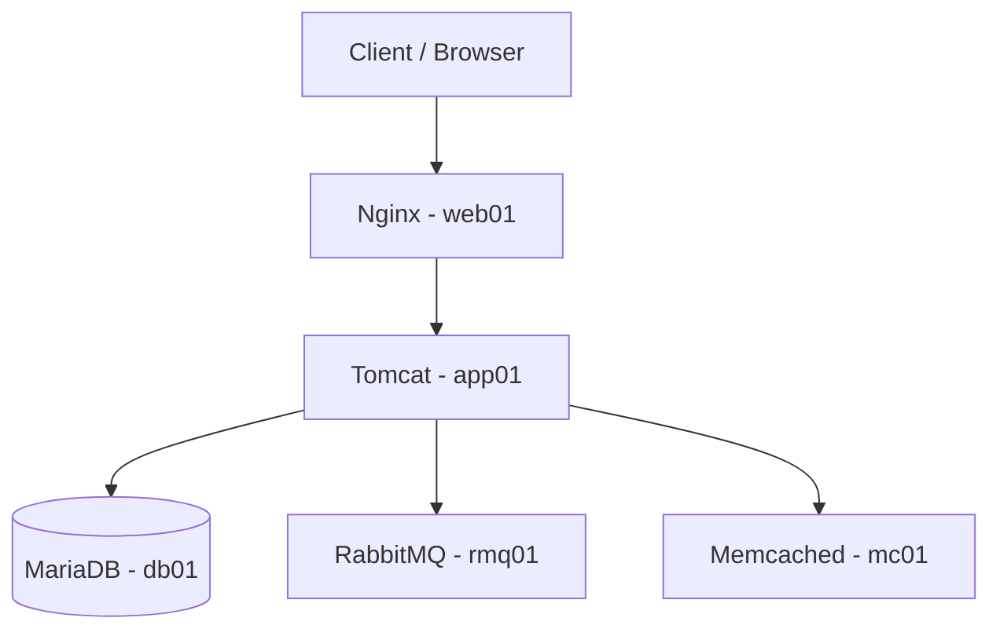
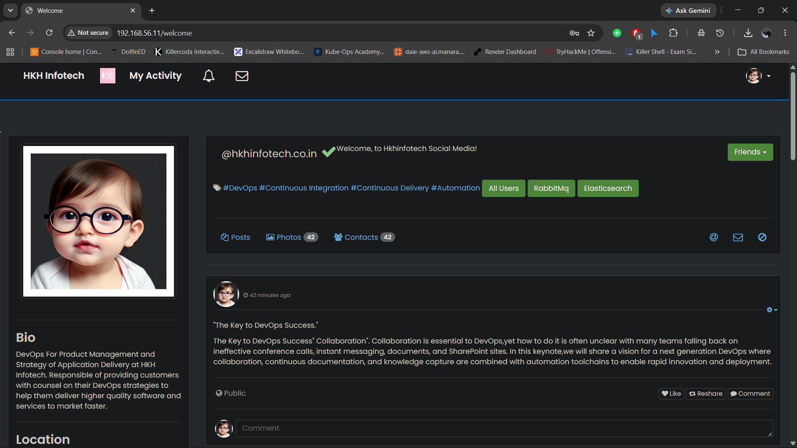
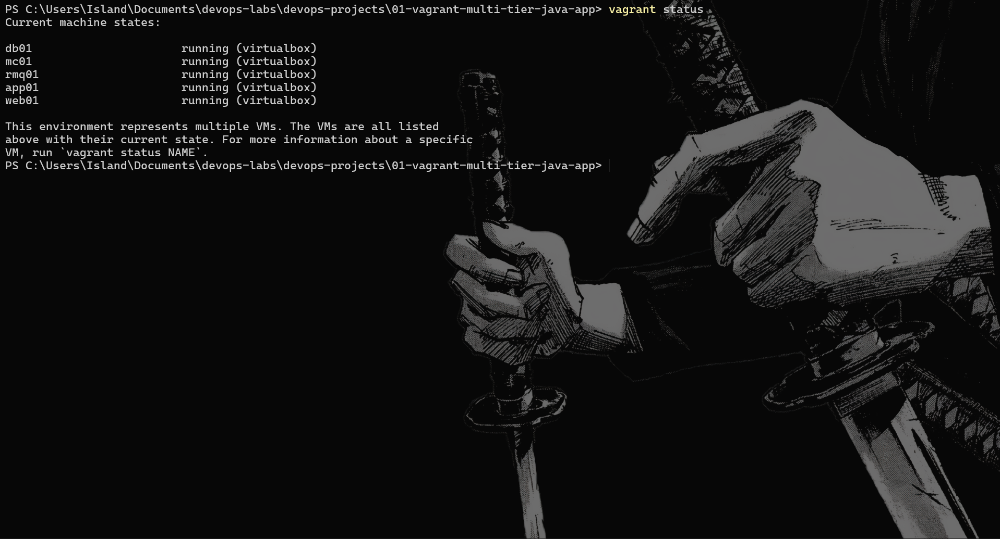

# Vagrant Multi-Tier Java Web Application

A multi-tier Java web application deployed on a virtualized infrastructure using Vagrant and VirtualBox.

This project automates the provisioning and configuration of five Ubuntu virtual machines running Nginx, Apache Tomcat, MariaDB, RabbitMQ, and Memcached.

## Architecture



## Infrastructure

| VM | Role | IP Address | Port | RAM |
|---|---|---|---|---|
| web01 | Nginx Reverse Proxy | 192.168.56.11 | 80 | 1 GB |
| app01 | Java Application Server | 192.168.56.12 | 8080 | 2 GB |
| rmq01 | Message Broker | 192.168.56.13 | 5672 | 1 GB |
| mc01 | Cache Server | 192.168.56.14 | 11211 | 1 GB |
| db01 | Database Server | 192.168.56.15 | 3306 | 2 GB |

**Total allocated RAM:** 7 GB

## Technology Stack

- Virtualization: VirtualBox
- Provisioning: Vagrant
- Operating System: Ubuntu 22.04 LTS
- Web Server: Nginx
- Application Server: Apache Tomcat 10.1.26
- Runtime: Java 17
- Build Tool: Apache Maven
- Database: MariaDB
- Message Broker: RabbitMQ
- Caching: Memcached
- Automation: Bash

## Project Structure

```text
01-vagrant-multi-tier-java-app/
├── Vagrantfile
├── README.md
├── .gitignore
├── config.env.example
├── db_provision.sh
├── memcache_provision.sh
├── nginx_provision.sh
├── rabbitmq_provision.sh
└── tomcat_provision.sh
```

## Prerequisites

Install the following tools on your host machine:

- [VirtualBox](https://www.virtualbox.org/)
- [Vagrant](https://developer.hashicorp.com/vagrant/install)
- Git

Install the Vagrant Host Manager plugin:

```bash
vagrant plugin install vagrant-hostmanager
```

## Deployment

### 1. Clone the Repository

```bash
git clone https://github.com/omarnasser270/vagrant-multi-tier-java-app.git
cd vagrant-multi-tier-java-app
```

### 2. Configure Environment Variables

Create your local configuration file:

```powershell
Copy-Item config.env.example config.env
notepad config.env
```

Update the credentials:

```env
DB_NAME=accounts
DB_USER=admin
DB_PASS=YOUR_DB_PASSWORD

RMQ_USER=test
RMQ_PASS=YOUR_RABBITMQ_PASSWORD
```

Never commit `config.env` or expose real credentials.

### 3. Provision the Infrastructure

```bash
vagrant up
```

Vagrant will create and configure all five virtual machines using the provisioning scripts.

### 4. Verify VM Status

```bash
vagrant status
```

### 5. Access the Application

Open the following address in your browser:

http://192.168.56.11

Nginx acts as the frontend reverse proxy and forwards incoming requests to the Tomcat application server.

## Provisioning Scripts

| Script | Description |
|---|---|
| `nginx_provision.sh` | Installs and configures Nginx reverse proxy |
| `tomcat_provision.sh` | Installs Java, Maven, Tomcat, builds and deploys the application |
| `db_provision.sh` | Installs MariaDB and configures the database |
| `rabbitmq_provision.sh` | Installs RabbitMQ and configures its user |
| `memcache_provision.sh` | Installs and configures Memcached |

## Screenshots

### Application Dashboard


### Vagrant Infrastructure


### Multi-Tier Architecture


## Validation

The deployment was tested through the following checks:

- All five virtual machines started successfully.
- Required services were running.
- Network connectivity between infrastructure components was checked.
- Tomcat responded on port 8080.
- Nginx successfully forwarded HTTP requests to Tomcat.
- The application was accessible through the Nginx frontend.
- Application login and dashboard access were tested.

Test the frontend:

```bash
curl -I http://192.168.56.11
```

Expected HTTP response:

```text
HTTP/1.1 200
```

## Application Source

The Java application is based on the VProfile project:

[https://github.com/hkhcoder/vprofile-project](https://github.com/hkhcoder/vprofile-project)

During provisioning, the Tomcat script clones the `local` branch, configures the application properties, builds the project using Maven, and deploys the generated WAR file.

The application source is retrieved during provisioning and is not included in this repository.

Please respect the original project's license and attribution requirements.

## Security Considerations

- Credentials are stored in the local `config.env` file.
- `config.env` is excluded from Git using `.gitignore`.
- `config.env.example` contains placeholders only.
- The RabbitMQ administrator account is intended for this lab environment.
- Services communicate over the Vagrant private network.

This project is intended for educational and demonstration purposes. It is not production-hardened.

Production environments should use secrets management, TLS, restricted network access, and least-privilege accounts.

## Known Limitations

- Provisioning scripts are not fully idempotent.
- The Tomcat provisioning script removes and reinstalls the Tomcat directory during provisioning.
- Maven builds currently use `-DskipTests`.

